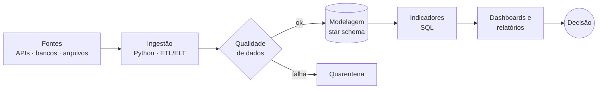

<div align="center">

[](https://brunofrancco.github.io/portifolio-de-projetos/)

<a href="https://brunofrancco.github.io/portifolio-de-projetos/"></a>
<a href="https://www.linkedin.com/in/brunofrancco/"></a>
<a href="mailto:brunofranccofr@gmail.com"></a>

</div>

---

### `$ whoami`

Trabalho na interseção entre **Análise de Dados** e **Engenharia de Dados**: construo pipelines que entregam dados
confiáveis e transformo esses dados em indicadores, relatórios e dashboards que respondem às perguntas do negócio.

```yaml
bruno_franco:
  atuacao: [Análise de Dados, Engenharia de Dados]
  foco:    [SQL, ETL/ELT, modelagem dimensional, qualidade de dados, BI]
  status:  aberto a oportunidades como Analista de Dados ou Engenheiro de Dados
```

### `$ cat como-eu-trabalho.md`



Cada projeto meu segue esse fluxo: **nenhum número chega ao negócio sem passar por validação**.

---

### `$ ls projetos/`

| | Projeto | O que entrega | Stack |
|:-:|---|---|---|
| 🛠️ | [**Plataforma de dados de RH**](https://github.com/brunofrancco/people-analytics-data-platform) | Pipeline ELT no Google Cloud: API de RH → BigQuery → star schema com dbt, orquestrado com Airflow e com dados pessoais mascarados (LGPD) | `BigQuery` `dbt` `Airflow` `Terraform` |
| 🛠️ | [**Analytics Engineering de e-commerce**](https://github.com/brunofrancco/ecommerce-analytics-engineering) | Da API REST ao dashboard: star schema em DuckDB, validações automáticas de qualidade e KPIs de receita e clientes | `Python` `DuckDB` `SQL` `Streamlit` |
| 🛠️ | [**Pipeline de uma seguradora digital**](https://github.com/brunofrancco/insurance-data-analytics) | 15 regras de qualidade com quarentena, star schema com snapshot mensal, 8 indicadores em SQL e relatórios automatizados | `Python` `SQL` `Pandas` `GitHub Actions` |
| 📊 | [**Superstore Sales Analytics**](https://github.com/brunofrancco/Analise-Exploratoria-de-Dados-Superstore-Sales-Analytics) | Mostrou que 100% dos pedidos com desconto de 50% ou mais dão prejuízo; Pareto, RFM e dashboard interativo | `Pandas` `SciPy` `Plotly` `Streamlit` |
| 📊 | [**Customer Analytics: qualidade de dados**](https://github.com/brunofrancco/customer-analytics-data-quality-eda) | Encontrou e removeu 180 clientes duplicados de uma base vinda de vários sistemas, com deduplicação por similaridade de nomes | `Pandas` `RapidFuzz` `SciPy` `pytest` |

<sub>🛠️ engenharia de dados · 📊 análise de dados — detalhes de cada um no [portfólio](https://brunofrancco.github.io/portifolio-de-projetos/).</sub>

---

### `$ stack --list`

| Área | Ferramentas |
|---|---|
| **Linguagens e análise** |      · SQL, estatística e testes de hipótese |
| **Bancos de dados** |        · BigQuery |
| **Engenharia e orquestração** |       · dbt |
| **Cloud** |    |
| **BI e visualização** |  · Power BI · Tableau · Looker Studio · Metabase |

---

<div align="center">


</div>

<picture>
  <source media="(prefers-color-scheme: dark)" srcset="https://raw.githubusercontent.com/Brunofrancco/Brunofrancco/output/github-contribution-grid-snake-dark.svg">
  
</picture>


