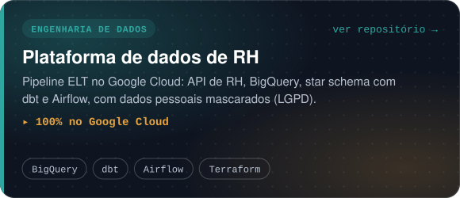
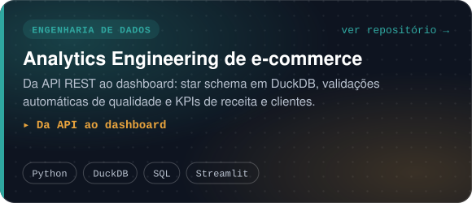
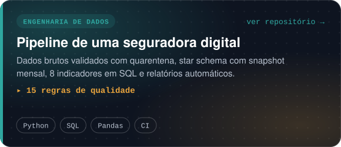
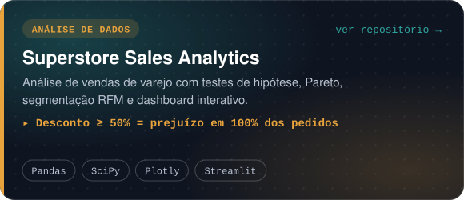
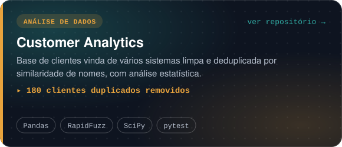
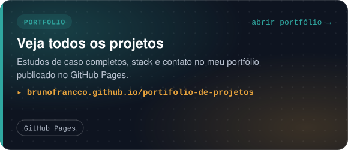

 

Trabalho na interseção entre **Análise de Dados** e **Engenharia de Dados**: construo pipelines que entregam
dados confiáveis e transformo esses dados em indicadores, relatórios e dashboards que respondem às perguntas
do negócio. Busco oportunidades como **Analista de Dados** ou **Engenheiro de Dados**.

 

 

  
  
  
  
  
  

 

 

  

 

